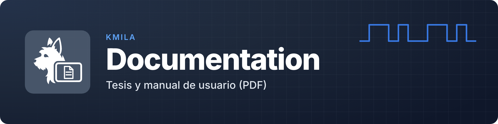
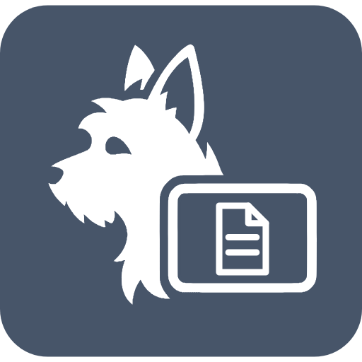

<a href="README.md">English</a>

Este repositorio publica los **documentos compilados** de Kmila. Las fuentes LaTeX viven en el GitLab privado del proyecto; cada versión etiquetada de la documentación se compila en CI y se adjunta aquí como release.

| | Documento | Archivo en cada release |
|---|---|---|
|  | **Tesis TT2 (final)** | `kmila-tt2-<tag>.pdf` |
|  | **Manual de usuario** | `kmila-manual-<tag>.pdf` |
|  | **Tesis TT1 (histórico)** | `kmila-tt1-<tag>.pdf` |

<a href="https://github.com/Kmila9s/Documentation/releases/latest"><b>Descargar la última versión</b></a>

## La familia Kmila

| | | |
|---|---|---|
|  | [**Kmila**](https://github.com/Kmila9s/Kmila) | Escribe, simula y depura HDL sin FPGA |
|  | [**Parser**](https://github.com/Kmila9s/Parser) | Analizador léxico y sintáctico de VHDL para Kmila |
|  | [**Interpreter**](https://github.com/Kmila9s/Interpreter) | Motor de simulación por ciclos delta y síntesis |
|  | [**Debugger**](https://github.com/Kmila9s/Debugger) | Validación estructural y lint de diseños VHDL |
|  | [**LibraryCompiler**](https://github.com/Kmila9s/LibraryCompiler) | Librerías IEEE, cláusulas use y primitivas |
|  | [**TimeMachine**](https://github.com/Kmila9s/TimeMachine) | Base de tiempo discreta: ticks, relojes y eventos |
|  | [**PracticeValidator**](https://github.com/Kmila9s/PracticeValidator) | Valida cada práctica contra GHDL |
|  | [**SimulatorBench**](https://github.com/Kmila9s/SimulatorBench) | Banco de exactitud Kmila contra GHDL |
|  | [**Tests**](https://github.com/Kmila9s/Tests) | Pruebas unitarias, de extremo a extremo y de rendimiento |

## Licencia

MIT © 2026 Ulrich Tamayo Daniel. Consulta [LICENSE](LICENSE).

Desarrollado como Trabajo Terminal TT 2026-B059 en el IPN ESCOM (México).
