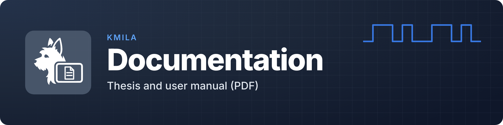

<a href="README.es.md">Español</a>

This repository publishes the **compiled documents** of Kmila. The LaTeX sources live in the project's private GitLab; every tagged documentation version is built by CI and attached here as a release.

| | Document | File in each release |
|---|---|---|
|  | **Thesis TT2 (final)** | `kmila-tt2-<tag>.pdf` |
|  | **User manual** | `kmila-manual-<tag>.pdf` |
|  | **Thesis TT1 (historical)** | `kmila-tt1-<tag>.pdf` |

<a href="https://github.com/Kmila9s/Documentation/releases/latest"><b>Download the latest release</b></a>

## The Kmila family

| | | |
|---|---|---|
|  | [**Kmila**](https://github.com/Kmila9s/Kmila) | Write, simulate and debug HDL without an FPGA |
|  | [**Parser**](https://github.com/Kmila9s/Parser) | VHDL lexer and front-door parsing for Kmila |
|  | [**Interpreter**](https://github.com/Kmila9s/Interpreter) | Delta-cycle HDL simulation engine and synthesis |
|  | [**Debugger**](https://github.com/Kmila9s/Debugger) | Structural checks and lint for VHDL designs |
|  | [**LibraryCompiler**](https://github.com/Kmila9s/LibraryCompiler) | IEEE libraries, use clauses and primitive lowering |
|  | [**TimeMachine**](https://github.com/Kmila9s/TimeMachine) | Discrete time base: ticks, clocks and events |
|  | [**PracticeValidator**](https://github.com/Kmila9s/PracticeValidator) | Validates every practice against GHDL |
|  | [**SimulatorBench**](https://github.com/Kmila9s/SimulatorBench) | Kmila vs GHDL accuracy bench |
|  | [**Tests**](https://github.com/Kmila9s/Tests) | Unit, end-to-end and performance suites |

## License

MIT © 2026 Ulrich Tamayo Daniel. See [LICENSE](LICENSE).

Developed as the degree project TT 2026-B059 at IPN ESCOM (Mexico).
